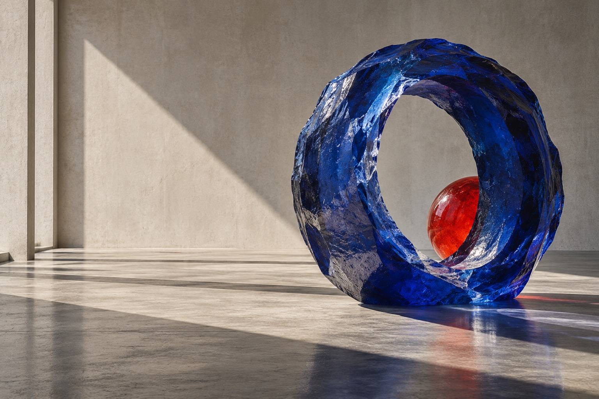

# FRAME

**Experimental Digital Studio**

FRAME is an editorial studio website and interactive visual archive built with semantic HTML, modern CSS, and vanilla JavaScript. The page treats a portfolio as an exhibition: an opening sequence leads into a typographic landing, a deliberately uneven project index, a short studio statement, and an interactive color study.

## Features

- Short, skippable opening sequence; it is skipped for reduced-motion preferences and after its first display in the current tab.
- Responsive editorial layout with a full-screen navigation overlay on small screens.
- Six concept projects rendered from a separate data file, with working category filters and fullscreen detail overlays containing description, image, role, and credits.
- Pointer-following desktop cursor and a pointer-reactive color study.
- Scroll-triggered reveals and active section navigation using `IntersectionObserver` with a non-animated reveal fallback.
- Keyboard-operable controls, visible browser focus, semantic sections, dialog escape handling, and reduced-motion support.
- Generated original artwork for the hero and first project; additional editorial imagery is loaded from Unsplash.

## Tech Stack

- HTML5
- CSS3 (Grid, custom properties, media queries, transitions)
- Vanilla JavaScript (data-driven DOM rendering, delegated events, `IntersectionObserver`, `requestAnimationFrame`, native `<dialog>`)
- No build tools, framework, package install, API, or backend required

## Design Direction

FRAME uses warm paper, near-black typography, cobalt blue, and vermilion. Large compressed headlines sit against restrained labels and open space. The project index shifts between wide and narrow images rather than repeating a uniform card grid. The generated glass sculpture sets the visual tone; the project images can be changed in `js/projects.js` without changing the layout.

## Interaction System

The category buttons filter the archive in place and update the count. Selecting a project opens an accessible fullscreen native dialog rendered from project data, with title, category, year, description, large image, role, and credits. The dialog animates in and out, restores focus on close, and closes with Escape. The navigation overlay opens and closes by button, link, and Escape; active sections are tracked while scrolling. On fine-pointer devices a custom cursor expands over projects and changes over navigation. The blue study moves its central form and updates its coordinate readout as the pointer travels.

## Architecture

```text
index.html
css/style.css
js/projects.js       project content
js/app.js            rendering, filters, navigation, dialog, reveals, intro
js/interactions.js   cursor and pointer study
assets/images/       original generated artwork
case-study.md
resume-bullets.md
```

## Performance

The site has no runtime dependencies. Project thumbnails load lazily and decode asynchronously; the hero artwork is prioritized. Motion uses transform and opacity where practical, and pointer updates are frame-coalesced. The visual texture is a small inline SVG filter. Unsplash imagery is served remotely and can be replaced with local optimized files for offline or production deployment.

## Accessibility

The page uses landmarks, descriptive image alt text, labeled filters, native buttons and a native dialog. Keyboard users can open and close navigation and project details. Reduced-motion preferences disable the intro and reveal motion. The custom cursor is hidden on touch-sized pointers.

## Responsive Design

At narrow widths the desktop project composition becomes a single-column, staggered index; navigation and headings scale down and the custom cursor disappears. The stylesheet includes breakpoints for phone widths and a maximum content width is not imposed so the composition remains full-bleed.

## Installation

No install step is needed. From this directory, run any static file server, for example:

```sh
python3 -m http.server 8000
```

Then open `http://localhost:8000`. An internet connection is needed for the Google Fonts and Unsplash assets; the page itself is static.

## Usage

Use the menu to jump between sections, filter the work index, open any project for its detail view, or move through the blue study. Replace project objects in `js/projects.js` to update titles, descriptions, imagery, categories, years, roles, and credits. The six displayed projects are fictional concept studies created for this portfolio.

## Future Improvements

- Replace remote project imagery with a consistent set of locally hosted, art-directed assets.
- Add a curated project archive and individual project case-study pages.
- Add final desktop and mobile screenshots after selecting a deployment target.
- Connect the contact address to the studio's real inbox before publishing.

## Screenshots

Hero artwork preview (the page uses an optimized JPEG; the original PNG is retained as the full-resolution source):



A full-page browser capture can be added after deployment; no live deployment exists yet.

## Live Demo

Not published.

## GitHub

Not published.
